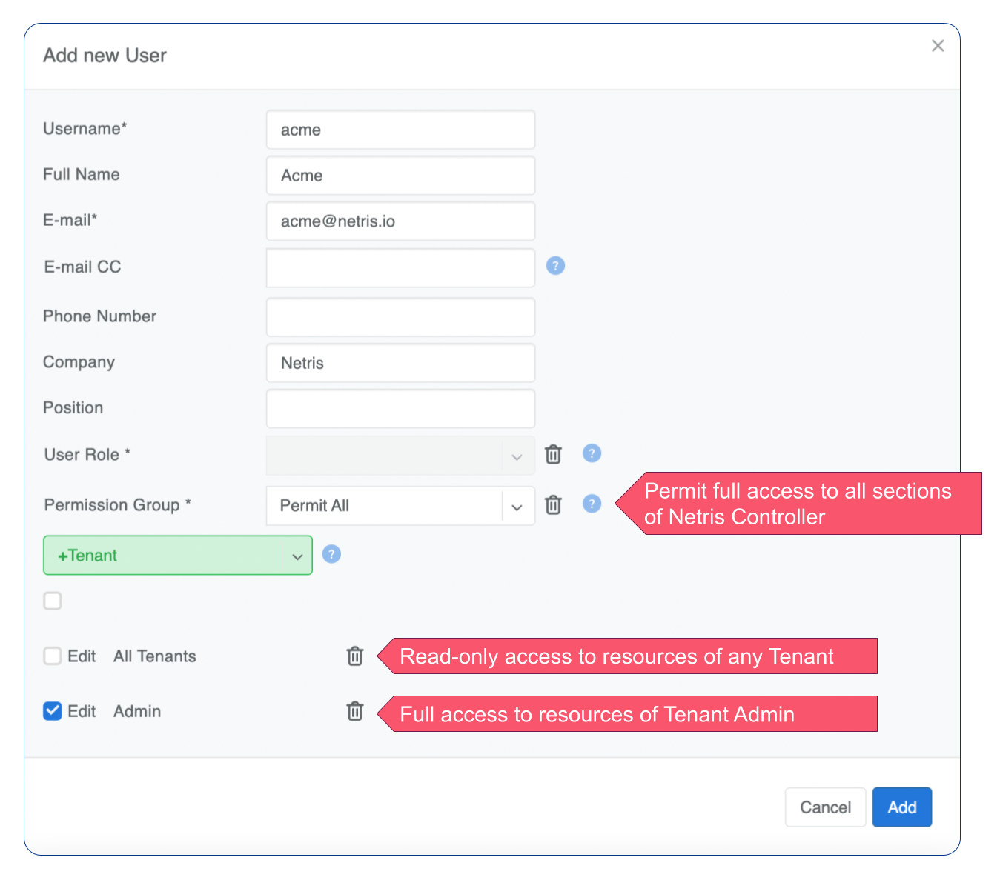
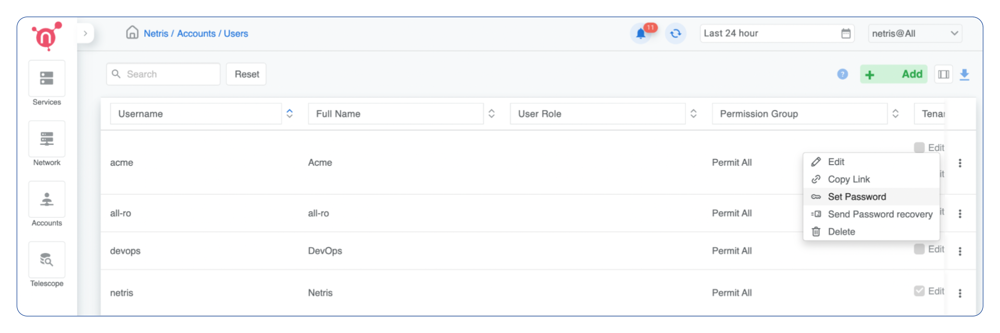
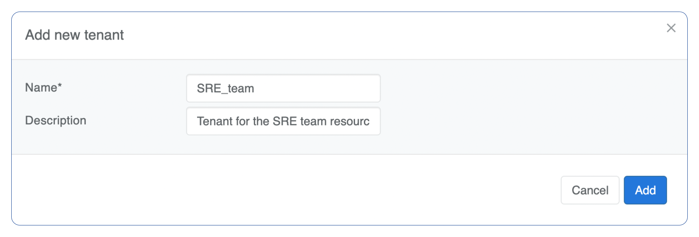
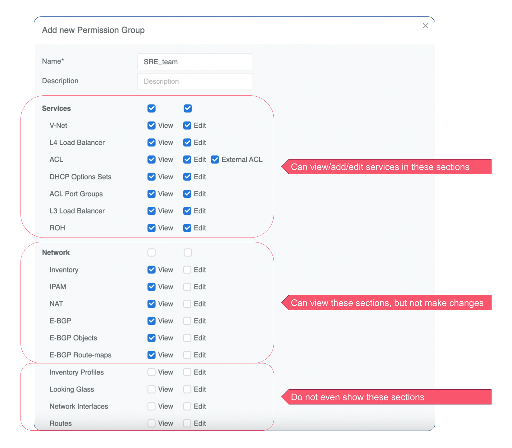
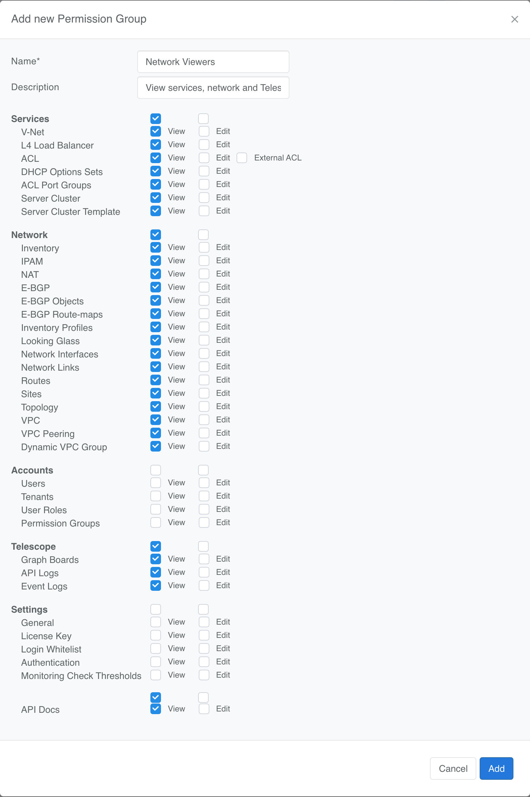
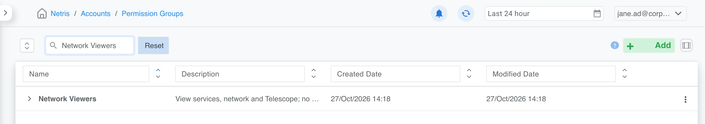
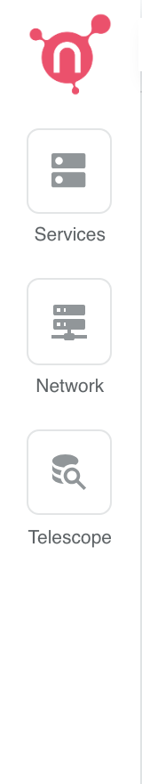
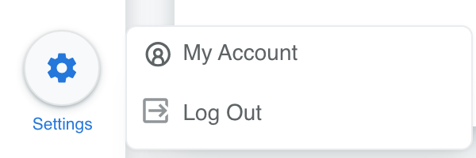
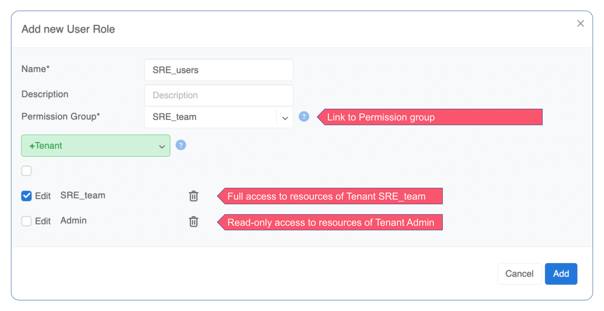
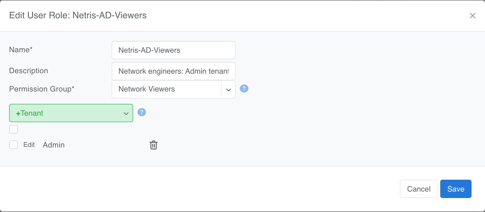

.. meta::
    :description: Netris Controller User Account Management

########
Accounts
########

The accounts section is for the management of user accounts, access permissions, and tenants.

Users
=====
Description of User account fields:

* **Username** - Unique username.
* **Full Name** - Full Name of the user. 
* **E-mail** - The email address of the user. Also used for system notifications and for password retrieval.
* **E-mail CC** - Send copies of email notifications to this address.
* **Phone Number** - User's phone number.
* **Company** - Company the user works for. Usually useful for multi-tenant systems where the company provides Netris Controller access to customers.
* **Position** - Position within the company.
* **User Role** - When using a User Role object to define RBAC (role-based access control), the Permission Group and Tenant fields will be deactivated.
* **Permission Group** - User permissions for viewing and editing parts of the Netris Controller. (if User Role is not used)
* **+Tenant** - User permissions for viewing and editing services using Switch Port and IP resources assigned to various Tenants. (if User Role is not used)

Example: Creating a user with full access to all sections of Netris Controller, read-only access to resources managed by any Tenant, and full access to resources assigned to the Tenant Admin.

.. raw:: html

   
<em>Figure: User Management</em>

**Password**: To set a password or email the user a password form, go to the username list and click the menu on the right.

.. raw:: html

   
<em>Figure: List User Accounts</em>

Accounts created here sign in with the built-in **local** authentication scheme. A controller connected to Active Directory also creates accounts automatically from AD group membership, and those appear in the same list — see :doc:`Authentication <authentication>`.

Tenants
=======

Tenants are named principals used to delegate management of network resources. The built-in ``Admin`` tenant owns all resources by default. Additional tenants grant other teams self-service access to provision and manage network services via the Netris Controller GUI, Kubernetes CRDs, or Terraform.

A Tenant object has only two fields: a unique name and an optional description. It carries no quota, billing identity, or login.

For a glossary of related concepts — including **Admin Tenant** and **Guest Tenant** — see :doc:`definitions`.

Admin Tenant vs Guest Tenant
----------------------------

VPCs and V-Nets in Netris support two tenant roles:

* The **Admin Tenant** owns the object and can manage all of its parameters.
* **Guest Tenants** are tenants granted delegated access to add and remove resources inside the object, but cannot change the object's parameters.

For a VPC, the Admin Tenant manages all VPC-level parameters. Guest Tenants of a VPC can add and remove services inside it — V-Nets, L4 Load Balancers, Server Clusters, IPAM subnets — but cannot change the VPC's own parameters.

For a V-Net, the Admin Tenant manages all V-Net parameters. Guest Tenants of a V-Net can add and remove switch ports to the V-Net, but cannot change the V-Net's own parameters.

Example: Adding a tenant.

.. raw:: html

   
<em>Figure: Adding Tenants</em>

Permission Groups
=================

Permission Groups are a list of permissions per section that can be attached individually to a User or a User Role. Each section has View and Edit attributes. View defines whether users with this Permission Group can see the section at all. Edit defines if users with this Permission Group can edit services and policies in specific sections.

The two checkboxes combine as follows:

.. list-table::
   :header-rows: 1
   :widths: 12 12 76

   * - View
     - Edit
     - Result for the user
   * - off
     - off
     - The section is hidden: it doesn't appear in the menus.
   * - on
     - off
     - The section is read-only: the user can look but not add, change or delete.
   * - on
     - on
     - Full access to the section.

The checkboxes on a category's own line (Services, Network, Accounts, Telescope, Settings) set View or Edit for every section in that category at once. The ACL section also has **External ACL**, which controls whether the user can manage ACLs with external networks.

Netris includes **Permit All**, which gives full access to every section. Create your own permission groups to give narrower access.

Example: Permission Group.

.. raw:: html

   
<em>Figure: Managing Permissions</em>

Example: a read-only permission group
-------------------------------------

Go to **Accounts → Permission Groups → Add**. In this example, *Network Viewers* lets members look at services, the network and Telescope without changing anything, and hides Accounts and Settings completely:

.. raw:: html

   
<em>Figure: Network Viewers: View on Services, Network, Telescope and API Docs, no Edit, and Accounts and Settings hidden.</em>

Click **Add**. The group appears in the list:

.. raw:: html

   
<em>Figure: The Network Viewers permission group in the list</em>

A member of a user role that uses *Network Viewers* doesn't see Accounts in the navigation, and their Settings menu only offers **My Account** and **Log Out**:

.. raw:: html

   
<em>Figure: No Accounts item between Network and Telescope.</em>

.. raw:: html

   
<em>Figure: Only My Account and Log Out under Settings.</em>

.. tip::

   **Permission groups and tenants.** The permission group decides which sections a user can see and change. The tenants on the user (or on the user role) decide which tenants' resources the user can work with, and whether they can change them. A user can change something only when both allow it.

User Roles
==========

Permission Groups and Tenants can be linked either directly to an individual username or to a User Role object, which can then be linked to an individual username.

.. raw:: html

   
<em>Figure: User Roles</em>

Go to **Accounts → User Roles → Add**. A user role has:

* **Name** — a unique name for the role.
* **Permission Group** — the sections members can see and change, for example *Permit All* for administrators, or *Network Viewers* from the example above.
* **+Tenant** — the tenants members can work with. Tick **Edit** next to a tenant to allow changes there; leave it unticked for read-only access to that tenant. Choose **All Tenants** to cover every tenant at once.

.. raw:: html

   
<em>Figure: A role using the Network Viewers permission group, with read-only access to the Admin tenant.</em>

.. note::

   **User roles and Active Directory.** When the controller authenticates users against Active Directory, the role's **Name** also does the group mapping: a role whose name matches an AD group's CN is given to members of that group at sign-in. See :doc:`Authentication <authentication>`.

