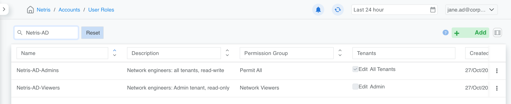
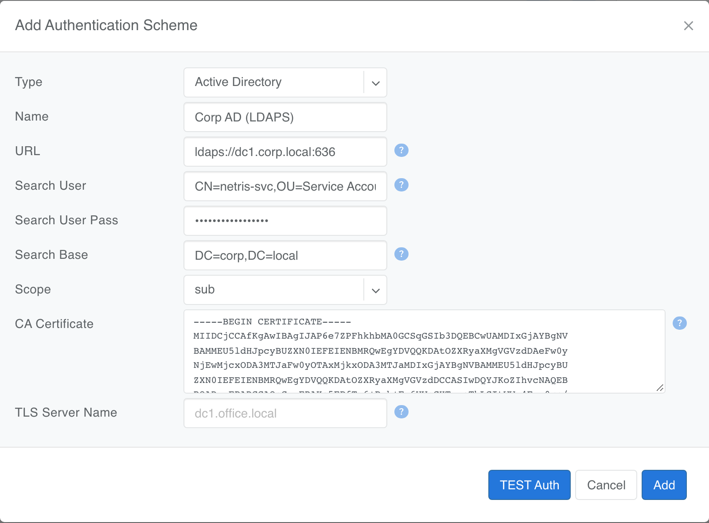
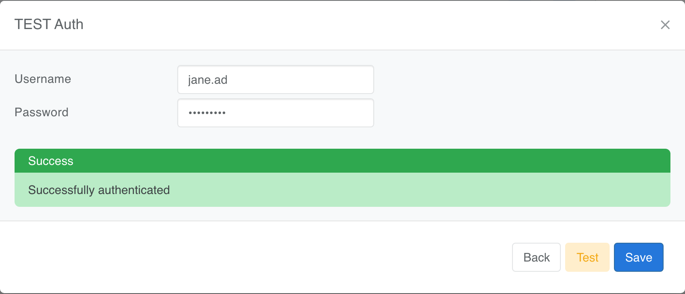
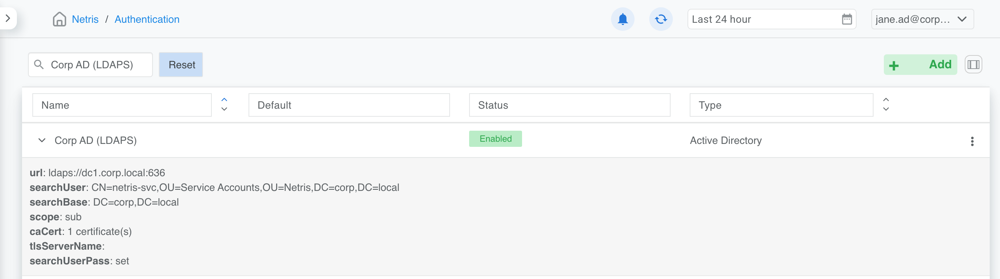
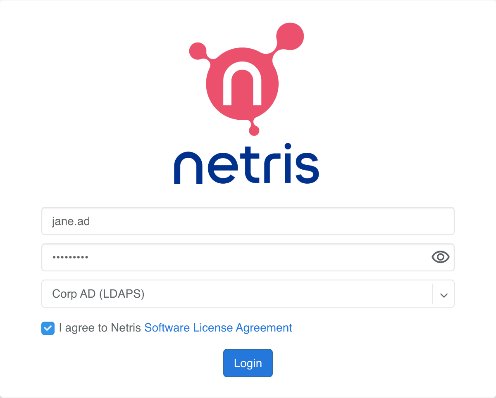

.. meta::
    :description: Netris Controller Authentication: local and Active Directory (LDAPS) authentication schemes

.. _authentication:

##############
Authentication
##############

.. contents:: Table of Contents
   :local:
   :depth: 4

The Netris Controller signs users in through **authentication schemes**, managed under **Settings → Authentication**. A scheme determines where the controller checks a user's password and where it gets their permissions. Every controller has the built-in **local** scheme; you can add an **Active Directory** scheme on top of it.

Whichever schemes exist, what a signed-in user may see and do always comes from a Netris **user role** and the **permission group** that role uses. Both are created under **Accounts** and are described in :doc:`Accounts <accounts>`. Authentication decides who the user is; those two decide what they can do.

The local scheme
================

**local** is the controller's built-in scheme and the default until you change it. It has nothing to configure — it has no settings page and no fields — and the controller will not let you delete or disable it, so it is always available as a way in.

Under local, accounts live in the controller itself: you create each user under **Accounts → Users**, assign their user role there, and the controller stores and checks their password. You create users, reset passwords, and remove leavers in Netris, not in a directory. There is no configurable password policy — no complexity rules, expiry, or lockout settings to set.

On the login page, local appears in the scheme list like any other scheme. Users signing in against it enter their Netris username and password.

.. note::

   **Keep a local admin account.** Even after you add Active Directory, keep at least one local administrator. If the domain controller, its certificate, or the network path to it becomes unavailable, every AD login fails, and the local account is the only way back into the controller.

Active Directory authentication
===============================

An Active Directory scheme connects the controller to your AD domain over LDAPS, so network engineers log in with their AD accounts and get their Netris permissions from AD group membership. You can run it alongside local and make it the default for the login page.

How it works
------------

When someone signs in with an Active Directory scheme, the controller does the following. The examples throughout this page use a domain called ``corp.local``, reached through a domain controller named ``dc1.corp.local``, and a user whose logon name is ``jane.ad``.

#. Connects to your domain controller over LDAPS and signs in as a read-only service account — the "search user".
#. Searches the search base for the person logging in by their logon name (``sAMAccountName``, for example, ``jane.ad``).
#. Verifies the password by opening a second connection and signing in to AD as that person, rather than as the search user. The directory, not Netris, decides whether the password is correct; Netris never stores it.
#. Reads the person's AD groups. A group whose name matches a Netris user role gives them that role. If several groups match, their permissions are merged — see :ref:`Users in more than one group <auth-multi-group>`.
#. Creates or updates a Netris account for them, named after their logon name and domain — ``jane.ad@corp.local`` — with the matching role, so there is nothing to pre-create per user.

Before you start
----------------

* **A service account** for Netris to search the directory. A standard domain user account is enough — one that is only a member of **Domain Users**, with no delegated or administrative rights. It only needs to read users and groups, which any authenticated domain account can do by default. Use a password that doesn't expire, because an expired password stops every AD login. Example: ``CN=netris-svc,OU=Service Accounts,OU=Netris,DC=corp,DC=local``
* **Network access** from the Netris Controller to a domain controller on TCP 636 (LDAPS). The controller opens this connection itself; no agent or switch is involved. It doesn't bind the connection to a particular interface — the traffic follows the controller's own routing, which on an HA deployment means the pod network and then the node's route to the domain controller's address, normally the default route. Open the path accordingly, and expect the connection to come from whichever controller node is running the API at the time.
* **The CA certificate** that issued your domain controller's LDAPS certificate, in PEM format — see :ref:`Getting the CA certificate <auth-ca-cert>` below for how to obtain it. If the DC uses a self-signed certificate, use that certificate itself.
* **The list of AD groups** that should have access to Netris, and the level of access each should get. Netris does not discover these: ask your AD administrator for the group names (each group's CN, not its full DN), then decide with them which Netris permissions each group needs. You turn that list into Netris roles in step 1.
* **A local Netris admin account** kept as a fallback, as described under *The local scheme* above.

.. _auth-ca-cert:

Getting the CA certificate
^^^^^^^^^^^^^^^^^^^^^^^^^^

**From Windows.** On a machine joined to the domain, open PowerShell, export your enterprise CA's certificate — the CA named in the bullet above, the one that issued the DC's LDAPS certificate — convert it to PEM and print it:

.. code-block:: powershell

   certutil '-ca.cert' C:\ca.cer
   certutil -encode C:\ca.cer C:\ca.pem
   Get-Content C:\ca.pem

.. tip::

   **Note.** Keep the quotes around ``'-ca.cert'``. PowerShell splits an unquoted ``-ca.cert`` at the dot, and ``certutil`` then reports too many arguments. In the classic Command Prompt (``cmd.exe``), the quotes aren't needed.

**From Linux.** From any host that can reach the domain controller, show the certificate chain the DC presents and copy the last certificate in the output (the CA), including its ``-----BEGIN CERTIFICATE-----`` and ``-----END CERTIFICATE-----`` lines:

.. code-block:: bash

   openssl s_client -connect dc1.corp.local:636 -showcerts </dev/null

.. _auth-cert-hostnames:

Finding the host names on the DC certificate
^^^^^^^^^^^^^^^^^^^^^^^^^^^^^^^^^^^^^^^^^^^^

The URL you enter in step 2 must use a host name the domain controller's certificate is valid for: either the Common Name in the certificate's **Subject**, or a DNS entry in its **Subject Alternative Name**.

**From Linux.** The ``openssl s_client`` command above prints the certificate it is presented with, including both fields, so if you used that method you already have the list.

**From Windows.** On the domain controller, run ``certlm.msc``, expand **Personal → Certificates**, and open the certificate whose intended purpose is *Server Authentication* and that is issued to the DC's fully qualified host name. On the **Details** tab, read the **Subject** and **Subject Alternative Name** fields.

.. tip::

   **Note.** ``certlm.msc`` opens the Local Computer's Personal store. A domain controller can also hold an LDAPS certificate in the Active Directory Domain Services (NTDS) store; if one is present, the DC presents that certificate instead. To look in that store, run ``mmc.exe``, add the Certificates snap-in, choose **Service account → Local computer → Active Directory Domain Services**, and read its Personal store.

The ``certutil`` commands under *Getting the CA certificate* don't help here — they export the CA's certificate, not the domain controller's.

Step 1. Create a Netris role for each AD group
----------------------------------------------

Netris permissions come from a user role and the permission group it uses, both created under **Accounts**. :doc:`Accounts <accounts>` describes how to build them. For Active Directory, only the role name matters.

Go to **Accounts → User Roles → Add** and create one role per AD group, with the role **Name** spelled like the AD group's name. Give each role the permission group and tenants that group's members should have.

.. note::

   **How a group becomes a role.** The role name is the only link between Active Directory and Netris. At sign-in, the controller takes the CN of each group the person belongs to and looks for a Netris user role with that name. The comparison ignores case, so ``Netris-AD-Admins`` and ``netris-ad-admins`` are the same name. Nothing else is configured or matched: there is no group DN, no object ID, and no mapping table. So a role named ``Netris-AD-Admins`` matches the group whose DN is ``CN=Netris-AD-Admins,OU=Groups,DC=corp,DC=local``, and a role named after the full DN matches nothing.

The result is one role per AD group:

.. raw:: html

   
<em>Figure: Netris-AD-Admins: Permit All on all tenants with Edit. Netris-AD-Viewers: Network Viewers on the Admin tenant, read-only.</em>

.. note::

   **Note.** AD groups without a matching Netris role are ignored, and a user with no matching group can't sign in.

.. _auth-multi-group:

Users in more than one group
----------------------------

.. tip::

   **Recommendation.** Make each user a member of only one of the AD groups you define as Netris roles. The user then gets exactly the access of that one role, which is the easiest setup to predict and to audit.

A user can still be a member of several groups that are defined in the Netris Controller. In that case, Netris merges the permissions of all those roles at sign-in. Two rules decide the result:

* **The most permissive role wins** — for tenants, for sections, and for External ACL.
* **Except that a specific tenant beats All Tenants.** Where one role grants All Tenants and another names a single tenant, the named tenant's setting applies to that tenant even when it is the more restrictive of the two.

In detail:

.. list-table::
   :header-rows: 1
   :widths: 25 75

   * - Setting
     - How the roles are combined
   * - Tenants
     - The user gets every tenant from every matching role. A tenant is writable if any role grants write on it.
   * - All Tenants vs. one tenant
     - If one role grants All Tenants and another role lists a specific tenant, the specific tenant's setting applies to that tenant — including when it is more restrictive. For example, All Tenants read-write from one group plus Admin read-only from another gives read-write everywhere except Admin, which is read-only.
   * - Read-only and hidden sections
     - A section stays read-only or hidden only if it is read-only or hidden in every matching role; the most permissive role wins.
   * - Permission group
     - If the roles use different permission groups, Netris creates a combined permission group, named after them (for example, ``NOC,Permit All``).

For each combination of groups, Netris creates a combined role named after the matching groups, for example ``Netris-AD-Admins,Netris-AD-Viewers``, and assigns it to the user. These combined roles appear under **Accounts → User Roles**. Netris rebuilds them from the individual roles at every sign-in, so change the individual roles, not the combined ones.

Step 2. Add the Active Directory scheme
---------------------------------------

Go to **Settings → Authentication → Add** and fill in the form:

.. list-table::
   :header-rows: 1
   :widths: 22 78

   * - Field
     - Value
   * - Type
     - Active Directory
   * - Name
     - ``Corp AD (LDAPS)`` — shown to users in the login page's scheme list, alongside **local**.
   * - URL
     - ``ldaps://dc1.corp.local:636`` — the address of a domain controller. Use ``ldaps://`` so passwords are encrypted, and a hostname that's on the DC certificate. Port 636 is the default for LDAPS.
   * - Search User
     - ``CN=netris-svc,OU=Service Accounts,OU=Netris,DC=corp,DC=local`` — the service account's full distinguished name.
   * - Search User Pass
     - The service account's password. Netris treats it as write-only: once saved, it is never shown in the GUI again and no API endpoint returns it, so it can be replaced but not read back.
   * - Search Base
     - ``DC=corp,DC=local`` — where to look for users. The domain root covers every OU; use a narrower OU to limit who can sign in.
   * - Scope
     - How deep to search below the Search Base. ``sub`` — the search base and everything below it (recommended). ``one`` — only objects directly under the search base, not in nested OUs. ``base`` — only the search base object itself, which finds a user only if the Search Base is that user's own DN.
   * - CA Certificate
     - Paste the PEM certificate from *Getting the CA certificate*, including the BEGIN and END lines. You can paste several certificates (for example, root and intermediate CA). Leave it empty only if the DC certificate was issued by a public CA.
   * - TLS Server Name
     - Leave empty when the URL uses a name that's on the DC certificate. If you must connect by IP address or an alias, enter a name that is on the certificate (for example ``dc1.corp.local``); Netris then connects to the URL but verifies the certificate against this name.

.. tip::

   **Use a dedicated service account.** Give the search user no privileges beyond reading users and groups, and don't reuse an account that has rights anywhere else in your environment.

.. raw:: html

   
<em>Figure: The completed form. Don't click Add yet; test it first.</em>

Step 3. Test with a real AD user
--------------------------------

Click **TEST Auth**, enter the logon name and password of an AD user who is a member of one of your mapped groups, and click **Test**. *Successfully authenticated* means the controller reached the DC over LDAPS, trusted its certificate, signed in as the service account, found the user, and verified their password.

.. raw:: html

   
<em>Figure: Use the short logon name (jane.ad), not jane.ad@corp.local.</em>

.. tip::

   **Note.** The test doesn't check group membership. If the test passes but the user can't sign in later, check step 1.

Then click **Save** (or **Add** for a new scheme).

Step 4. Check the saved scheme
------------------------------

Expand the scheme in the list to review its settings. The service account password is write-only: Netris shows whether one is stored, never the password itself.

.. raw:: html

   
<em>Figure: The saved scheme: caCert: 1 certificate(s) and searchUserPass: set.</em>

.. warning::

   **Editing later.** The password field opens empty. Leave it blank to keep the stored password. If you change the URL or Search User, enter the password again; Netris won't send a stored password to a different server or account.

Step 5. Make it the default (optional)
--------------------------------------

Until you change it, **local** is the default scheme on the login page. To preselect your AD scheme instead, open its **⋮** menu, choose **Set as default**, and confirm. Local stays in the list, so users can still pick it for the fallback admin account.

Step 6. Sign in
---------------

On the login page, users choose the AD scheme, enter their AD logon name and password, and accept the license agreement.

.. raw:: html

   
<em>Figure: Signing in as jane.ad with the Corp AD (LDAPS) scheme.</em>

After signing in, the user appears as ``jane.ad@corp.local`` in the top-right corner, with the access of their mapped role. They can also be found under **Accounts → Users**, next to any local accounts.

.. raw:: html

   
<em>Figure: The signed-in AD user in the controller header</em>

Group changes in AD take effect the next time the user signs in.

Troubleshooting
---------------

.. list-table::
   :header-rows: 1
   :widths: 35 65

   * - Message
     - Cause and fix
   * - ``Authentication has failed``
     - Wrong password, or the user isn't under the Search Base. Check the logon name (the short ``sAMAccountName``) and that the user's OU is inside the search base and within the Scope you set.
   * - ``Authorization failed``
     - The password was correct, but none of the user's AD groups match a Netris role name. Check the role names in step 1. Also check that the user signed in with the short logon name, not ``user@domain``.
   * - ``Invalid Credentials`` during TEST Auth
     - The Search User DN or Search User Pass is wrong, or the service account is locked, or its password has expired.
   * - ``unable to verify the first certificate``
     - The CA Certificate is missing or isn't the CA that issued the DC certificate. Paste the issuing CA (and any intermediate).
   * - ``Hostname/IP does not match certificate's altnames``
     - The host in the URL isn't on the DC certificate. Use a hostname from the certificate — see :ref:`Finding the host names on the DC certificate <auth-cert-hostnames>` — or set TLS Server Name to one.
   * - ``CA certificate must be one or more PEM certificates``
     - The pasted text isn't a PEM certificate. Paste the text form, including the ``-----BEGIN CERTIFICATE-----`` and ``-----END CERTIFICATE-----`` lines.
   * - ``Connection timeout`` or ``ECONNREFUSED``
     - The controller can't reach the DC on TCP 636. Check firewalls and that the DC has an LDAPS certificate installed.

If AD sign-in is broken and you need to get back into the controller, pick **local** on the login page and sign in with the local admin account.

Current limitations
-------------------

.. warning::

   * **Direct group membership only.** Netris reads the groups a user is directly a member of. If access is granted through a nested group (a team group inside ``Netris-AD-Admins``), add the users to the mapped group directly.
   * **Short logon names.** Users sign in with their ``sAMAccountName`` (``jane.ad``). Signing in with the user principal name (``jane.ad@corp.local``) isn't supported yet.
   * **One domain controller per scheme.** A scheme has a single URL, and Netris does not fail over to a second domain controller.
   * **Multi-group permission merge.** A user who matches more than one role can end up with less access than the merge rules describe — see :ref:`Users in more than one group <auth-multi-group>`.

See also
========

* :doc:`Accounts <accounts>`
* :doc:`General Settings <general-settings>`
