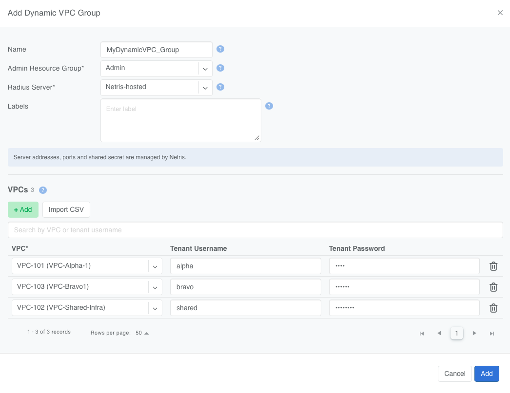
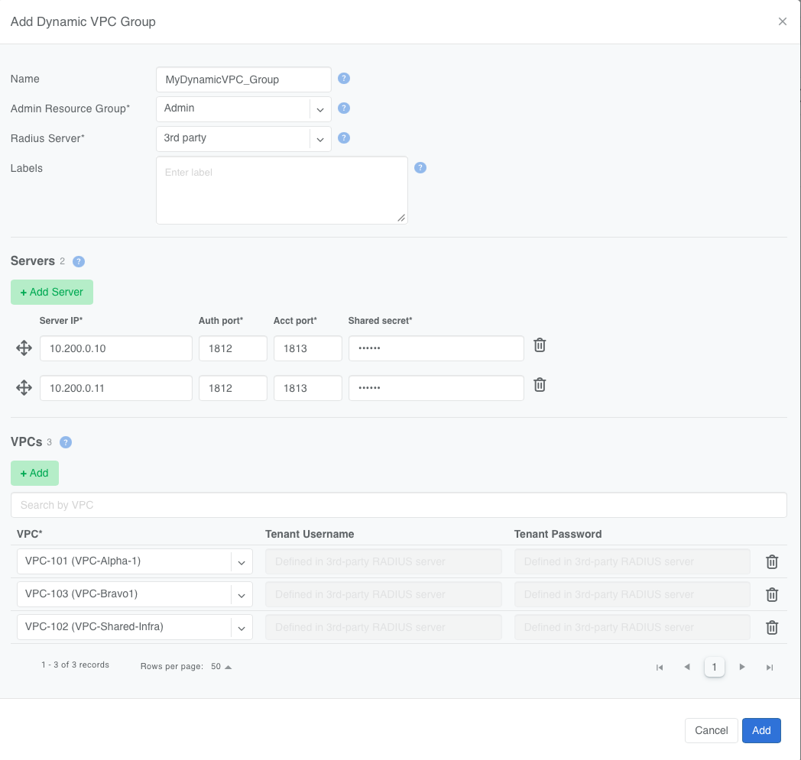
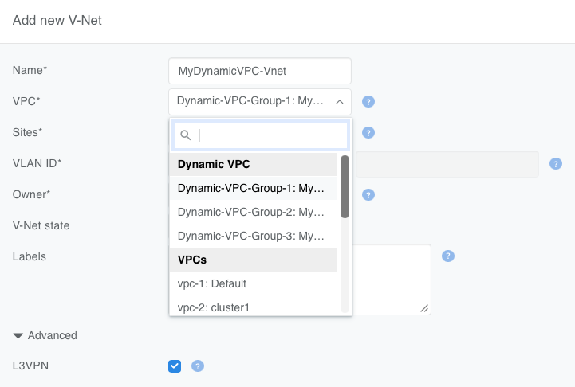
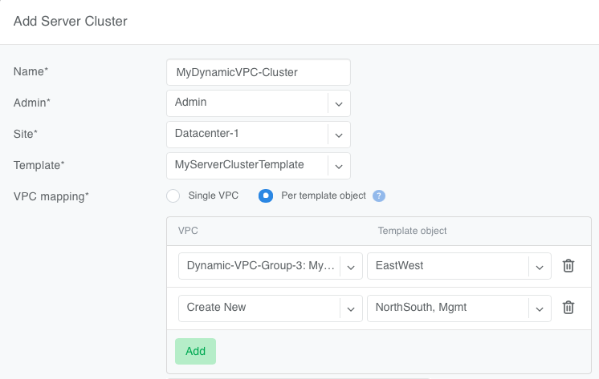

.. meta::
   :description: Dynamic VPC Assignment with 802.1X

.. _dynamic-vpc-assignment:

##################################
Dynamic VPC Assignment with 802.1X
##################################

.. contents:: Table of Contents
   :local:
   :depth: 3

Overview
--------

Dynamic VPC Assignment lets a server choose which VPC its switchport routes in by authenticating via 802.1X. RADIUS returns a VRF name at authentication time, and the switch places the switchport into that VRF.

You configure this in Netris with the **Dynamic VPC Group** object. A Dynamic VPC Group lists the VPCs that 802.1X can assign, and defines the RADIUS service that performs the assignment. An L3VPN V-Net is then created against a Dynamic VPC Group instead of against a single VPC.

The V-Net still defines which switchports participate and how their routed links are addressed. What becomes dynamic is the VRF each link is placed into, and therefore which VPC it belongs to. Two servers on the same V-Net can authenticate with different credentials and end up in different VPCs.

Netris provisions every VPC in the group as a VRF on every switch carrying the group's switchports, so the VRF exists before any server authenticates into it.

Why use it
----------

Server owners select their VPC without access to the Netris Controller. The server's credential, not an operator action in Netris, determines placement.

Moving a server from one VPC to another changes no switch configuration. The switchport moves between VRFs at authentication, so nothing is pushed to the switch and workloads already running on it are not disturbed.

To enable this, each switch carries a VRF for every VPC in the group it is mapped to, whether or not a server is currently using it.

Before you begin
----------------

.. list-table::
   :header-rows: 1
   :widths: 25 75

   * - Item
     - Requirement
   * - Switch platform
     - NVIDIA Cumulus Linux only. Dynamic VRF Assignment is not available on Dell SONiC or Arista EOS.
   * - Switch OS version
     - Cumulus Linux 5.18 or later
   * - Fabric
     - East-West
   * - V-Net type
     - L3VPN, with untagged member switchports
   * - Server side
     - An 802.1X supplicant configured with a username and password. If Netris Host Networking is used, it can configure the supplicant automatically; otherwise, any wired ``wpa_supplicant`` works. Netris Host Networking documentation is available from Netris on request.
   * - RADIUS
     - Netris-hosted, or an external server reachable from the switch ``mgmt`` VRF

Dynamic VPC Assignment applies to the East-West fabric. Server provisioning — PXE boot, imaging, out-of-band management — runs over the North-South or OOB fabric and is unaffected.

How it works
------------

#. You create VPCs as usual. Netris assigns each one an L3VNI and derives a VRF name, ``Vrf_<VPC ID>``.
#. You add those VPCs to a Dynamic VPC Group and choose the RADIUS model.
#. You create an L3VPN V-Net against the group instead of against a VPC, and add the server switchports to it as untagged members.
#. Netris maps each switch carrying those switchports to the group, provisions every member VPC of the group as a VRF on that switch, and enables 802.1X and RADIUS on the member switchports.
#. A server authenticates over 802.1X. RADIUS returns the VRF name of the VPC that the credential maps to, and the switch places that switchport's routed link into that VRF. Other switchports on the same V-Net keep whatever VRF their own authentication produced.

An unauthenticated switchport sits outside every VRF. A switchport that fails authentication also stays outside every VRF.

Planning constraints
--------------------

**A switch can be mapped to only one Dynamic VPC Group.** Netris derives the mapping from the member switchports of L3VPN :doc:`V-Nets <vnet>` and from :doc:`Server Cluster <server-cluster>` servers. An edit or a topology change that would map a switch to a second group is rejected:

   Switch <switch> is already mapped to Dynamic VPC Group <name>. A switch can be mapped to only one Dynamic VPC Group.

**Admin Resource Group and Radius Server are fixed at creation.** You can't change either after the group is added. Because a switch carries one group, the RADIUS model is in effect a decision for every switch that group lands on.

**A group in use cannot be deleted** while any L3VPN V-Net or Server Cluster references it, and a VPC that belongs to any group cannot be deleted. Removing a VPC from a group does not delete the VPC.

Choosing the RADIUS model
-------------------------

.. list-table::
   :header-rows: 1
   :widths: 24 38 38

   * -
     - Netris-hosted
     - 3rd party
   * - Who owns the credentials
     - The Netris operator
     - Whoever operates the RADIUS server
   * - Where credentials are defined
     - In the Dynamic VPC Group
     - On the external server
   * - Credentials per VPC
     - One per row. Add the VPC in several rows to issue several.
     - Defined on the external server and not limited by Netris. The group lists each VPC once.
   * - RADIUS ports
     - Always 1812 and 1813, on the Netris Controller.
     - Set per server. Non-standard ports need a Custom Rule — see the note below.
   * - What authentication depends on
     - The Netris Controller, which is where the RADIUS service runs. One service, no alternates.
     - The external RADIUS servers. Up to three, tried in the configured order.
   * - Operator also supplies
     - —
     - Shared secret, and the VRF name of each VPC

Choose **Netris-hosted** to keep credential management with the fabric operator. Netris runs RADIUS on the Controller, manages its addresses and shared secret, and registers every mapped switch as a RADIUS client.

This puts the Controller in the authentication path. While a switch cannot reach the Controller, a server that boots or reauthenticates on that switch cannot be placed into its VPC, and its switchport stays outside every VRF. Netris configures the switch to ignore reauthentication timeouts, which is intended to hold already-authenticated switchports in their VRF through an outage. A 3rd-party group moves this dependency onto the external servers, where up to three can be configured; weigh that against the credential-ownership question below.

Choose **3rd party** when the credential store belongs to someone else, such as a server owner or a separate identity team. You supply up to three servers and a shared secret; they define the users and the VRF each user receives.

Creating a Dynamic VPC Group
----------------------------

Go to **Network > Dynamic VPC Group** and click **Add**. Netris assigns the ID ``Dynamic-VPC-Group-<N>``.

Netris-hosted example
^^^^^^^^^^^^^^^^^^^^^

Acme Cloud runs three VPCs — ``alpha-vpc``, ``bravo-vpc`` and ``charlie-vpc`` — on a shared set of GPU servers, and keeps credential management in-house.

#. Set **Admin Resource Group** to the resource group that owns the VPCs.
#. Set **Radius Server** to **Netris-hosted**.
#. Under **VPCs**, click **Add** and select ``alpha-vpc``. Enter a Tenant Username and Tenant Password for the server that should land in it.
#. Repeat for ``bravo-vpc`` and ``charlie-vpc``.
#. Save.

.. raw:: html

    
<em>Figure: Dynamic VPC Group with Netris-hosted RADIUS</em>

Tenant Username and Tenant Password are optional here, so you can add the VPCs first and attach credentials later. **Import CSV** adds rows in bulk. To issue separate credentials for the same VPC — one per server, or one per team — add that VPC in several rows with different usernames.

3rd-party example
^^^^^^^^^^^^^^^^^

Acme Cloud's offtaker runs their own RADIUS server and issues their own credentials.

#. Set **Admin Resource Group**, and set **Radius Server** to **3rd party**.
#. Under **VPCs**, add ``alpha-vpc``, ``bravo-vpc,`` and ``charlie-vpc``. Tenant Username and Tenant Password are inactive and show *Provided by 3rd-party RADIUS server*.
#. Under **Servers**, click **Add Server** and enter the server IP, authentication port, accounting port, and shared secret. Add up to three. Drag the rows into the order the switch should try them.
#. Save.
#. Give the external RADIUS operator the VRF name of each VPC, and register each mapped switch as a client on their server using its NAS identifier and NAS IP.

.. raw:: html

    
<em>Figure: Dynamic VPC Group with a 3rd-party RADIUS server</em>

.. warning::

   **Non-standard RADIUS ports need a Custom Rule.** If a 3rd-party server uses any other authentication or accounting port, add a Custom Rule to the Inventory Profile permitting UDP from that source port, or authentication fails with nothing logged on the switch to explain it. This does not apply to Netris-hosted groups, which always use 1812 and 1813.

The group listing shows each member VPC's VRF name and the switches mapped to the group, along with their NAS identifier and NAS IP. Both sets of values are also available through the API.

Using a Dynamic VPC Group in an L3VPN V-Net
-------------------------------------------

An L3VPN V-Net normally resolves to one VPC, and every routed link in it is routed in that VPC's VRF. Bound to a Dynamic VPC Group, the V-Net resolves to no single VPC: each link is routed in the VRF its server authenticated into.

In the V-Net **VPC** dropdown, Dynamic VPC Groups appear under a **Dynamic VPC** header, above the VPCs. Select the group instead of a VPC.

.. raw:: html

    
<em>Figure: Selecting a Dynamic VPC Group in the V-Net VPC dropdown</em>

- Dynamic VPC Groups become selectable only when you select **L3VPN** in the **Advanced** section and select a **V-Net owner**.
- Every member switchport must be untagged. A tagged switchport is rejected and flagged.
- Like a VPC, you can set a Dynamic VPC Group only when you create the V-Net; it becomes read-only afterward.

Switchport IP addressing does not change: addresses come from the topology link parameters or from the V-Net.

Using a Dynamic VPC Group in a Server Cluster
---------------------------------------------

The VPC dropdowns in **VPC mapping**, for both **Single VPC** and **Per template object**, list Dynamic VPC Groups under a **Dynamic VPC** header. The Server Cluster Template itself does not change.

.. raw:: html

    
<em>Figure: Selecting a Dynamic VPC Group in Server Cluster VPC mapping</em>

A Dynamic VPC Group can be mapped only to untagged L3VPN template objects. With **Single VPC**, that means every object in the template must be an untagged L3VPN V-Net; otherwise, map the other objects individually with **Per template object**.

See :doc:`Server Cluster <server-cluster>` for more details.

Configuring the server
----------------------

The server authenticates with a standard wired 802.1X supplicant using EAP-MD5. The identity and password must match a Tenant Username and Tenant Password in the Dynamic VPC Group, or a user on the external RADIUS server.

With Netris Host Networking
^^^^^^^^^^^^^^^^^^^^^^^^^^^

Set the credentials in the ``[dynamic-vrf]`` section of ``/opt/netris/etc/netris.conf``:

.. code-block:: ini

   [dynamic-vrf]
   enabled  = true
   username = alpha-gpu-01
   password = <Tenant Password>

Netris Host Networking re-reads this section on every pass, so a credential change takes effect without restarting the service. It writes the supplicant configuration to ``/etc/wpa_supplicant/t1.conf`` and authenticates each plane PF with EAP-MD5. If either value is empty, it logs ``dynamic-vrf is enabled, but username or password is not set`` and makes no change.

Netris Host Networking documentation, covering installation and the rest of the host configuration, is available from Netris on request.

Without Netris Host Networking
^^^^^^^^^^^^^^^^^^^^^^^^^^^^^^

Configure a wired supplicant yourself on each interface facing a member switchport. Netris Host Networking is not required, and the switch does not distinguish between supplicants.

.. code-block:: text

   # /etc/wpa_supplicant/<config>.conf

   ctrl_interface=/var/run/wpa_supplicant
   update_config=1
   fast_reauth=1
   eapol_version=2
   ap_scan=0

   network={
       key_mgmt=IEEE8021X
       identity="alpha-gpu-01"
       eapol_flags=0
       eap=MD5
       password="<Tenant Password>"
   }

Start it per interface:

.. code-block:: shell

   wpa_supplicant -B -D wired -i <interface> -c /etc/wpa_supplicant/<config>.conf

VRF names
---------

Netris derives the VRF name of each VPC as ``Vrf_<VPC ID>``. This is the value RADIUS returns to place a switchport into that VPC, and it is shown in the group's member VPC table.

For a 3rd-party group, this is the value to configure against each user on the external server. The name is tied to the VPC, so adding or removing member VPCs changes the set of valid values, and the external server has to be kept in step.

What Netris configures on the switch
------------------------------------

For each switch mapped to a Dynamic VPC Group, the switch agent configures:

- Every member VPC of the group as a VRF. A VPC that belongs to several groups is configured once.
- The group's RADIUS servers, in the configured order, reached over the ``mgmt`` VRF.
- ``nas-identifier`` from the switch name, with any character other than a letter, digit, ``-`` or ``.`` replaced by ``-``, up to 253 characters.
- ``nas-ip-address`` from the switch management IPv4 address.
- 802.1X on the member switchports, with the settings the NVIDIA reference architecture requires. These are set by Netris and are not operator-configurable.

A VRF is removed from a switch only when no group or V-Net on that switch still uses the VPC. RADIUS configuration is removed when the switch is no longer mapped to any group.

Field reference
---------------

**Legend:** 🔴 Mandatory — 🔵 Optional — 🟡 Conditionally mandatory

.. list-table::
   :header-rows: 1
   :widths: 20 15 12 53

   * - Field
     -
     - Default
     - Values
   * - Name
     - 🔵
     - Empty
     - Free text. The group is always identified by its generated ID.
   * - Admin Resource Group
     - 🔴
     - —
     - An existing resource group. Only its VPCs can be members. Fixed after creation.
   * - Radius Server
     - 🔴
     - Netris-hosted
     - Netris-hosted or 3rd party. Fixed after creation.
   * - Labels
     - 🔵
     - Empty
     - Labels for filtering and search.
   * - VPC
     - 🔴
     - —
     - A VPC of the group's Admin Resource Group.
   * - Tenant Username
     - 🟡 Netris-hosted
     - —
     - 1–63 characters: letters, digits, ``.``, ``_``, ``-``, ``@``; starts with a letter or digit; case-sensitive; unique within the group.
   * - Tenant Password
     - 🟡 Netris-hosted
     - —
     - 8–128 printable ASCII characters, excluding ``"``, ``\`` and spaces. Mandatory when a Tenant Username is set.
   * - Server IP
     - 🟡 3rd party
     - —
     - IPv4 or IPv6 address, reachable from the switch ``mgmt`` VRF. Up to three servers.
   * - Auth port
     - 🟡 3rd party
     - 1812
     - 1–65535. Anything other than 1812 needs a Custom Rule on the Inventory Profile.
   * - Acct port
     - 🟡 3rd party
     - 1813
     - 1–65535. Anything other than 1813 needs a Custom Rule on the Inventory Profile.
   * - Shared secret
     - 🟡 3rd party
     - —
     - Secret shared between the switches and the RADIUS server.

Tenant Passwords and shared secrets are masked and cannot be revealed after they are saved.

API and Terraform
-----------------

The Dynamic VPC Group is available through the REST API at ``/api/v2/dynamic-vpc-group``, and through the Netris Terraform provider. V-Nets and Server Clusters reference it with ``dynamicVpcGroup``, which is mutually exclusive with ``vpc`` and accepted only for L3VPN.

Tenant Passwords and shared secrets are write-only. Every REST response returns them empty.

For a 3rd-party group, the API also returns read-only values the external RADIUS server has to match: the NAS identifier and NAS IP of each mapped switch, and the VRF name of each member VPC.
