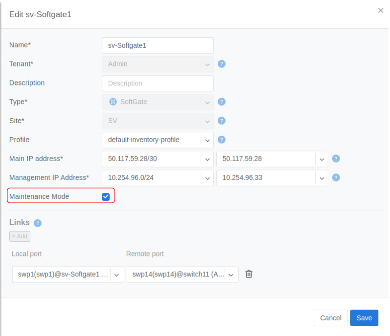

.. meta::
    :description: Netris System Visibility, Monitoring & Telemetry

**********************
Maintenance Mode
**********************

Overview
========
Maintenance mode is intended to assist in smoothly redirecting traffic away from a particular device for a maintenance to be carried out with minimal impact on your network. It's advisable to activate Maintenance Mode, wait a few minutes and ensure that traffic has been re-routed, prior to initiating maintenance procedures on the device. Once the maintenance is completed, you should deactivate Maintenance Mode to switchover the traffic back to normal. 

To toggle Maintenance Mode on or off, navigate to the Inventory section, or Topology manager (more convenient for switch-fabric). Edit the devices, and use the Maintenance Mode checkbox to enable/disable. 

.. note:: 
    Maintenance mode strives to redirect traffic away from the current device; however, please note that it does not guarantee the complete offloading of traffic.
    
Maintenance Mode for Softgate - What’s happening behind the scenes?
===================================================================

When you activate Maintenance Mode for the softgate, several automatic actions are undertaken behind the scenes to redirect traffic away from the softgate:

  - The BGP local preference attribute is lowered for both external and internal peers.
  - Route information is prepended tenfold for outbound direction to all external and internal peers.
  - The BGP MED attribute is increased for all external and internal peers.
  - The BGP origin attribute is decreased for all external and internal peers.
  - SNAT rules owned by this node are redistributed across the remaining SNAT SoftGates, and the TCP sessions those rules were carrying reset. DNAT, 1:1 NAT and L4LB are stateless and are unaffected: upstream routers simply ECMP that traffic across the remaining General SoftGates.

Deactivating Maintenance Mode on a SNAT SoftGate is equally disruptive. The rules move back to the recovered node and those sessions reset a second time, so plan the return into the maintenance window rather than only the drain.

.. note::
  Before activating Maintenance Mode, make sure the remaining SoftGates of the same role are healthy and have the capacity to carry the additional load.
  
Maintenance Mode for Switch - What’s happening behind the scenes?
=================================================================

When you activate Maintenance Mode for the switch, several automatic actions are undertaken behind the scenes to redirect traffic away from the switch:

  - The BGP local preference attribute is lowered for both external and internal peers.
  - Route information is prepended tenfold for outbound direction to all external and internal peers.
  - The BGP MED attribute is increased for all external and internal peers.
  - The BGP origin attribute is decreased for all external and internal peers.
  - The LACP system ID will undergo modification for EVPN Multihomed hosts, resulting in a reorganization of traffic from ports that connect to these multihomed hosts. The traffic will be redirected to other switches where the hosts are also linked.

.. note:: 
  If a host is connected to two switches, and the first switch is in Maintenance Mode, if the link connected to the second switch experiences instability (link flapping), the connection linked to the first switch will become active. However, this connection will not automatically revert back to the second switch once it stabilizes (no preemption).
