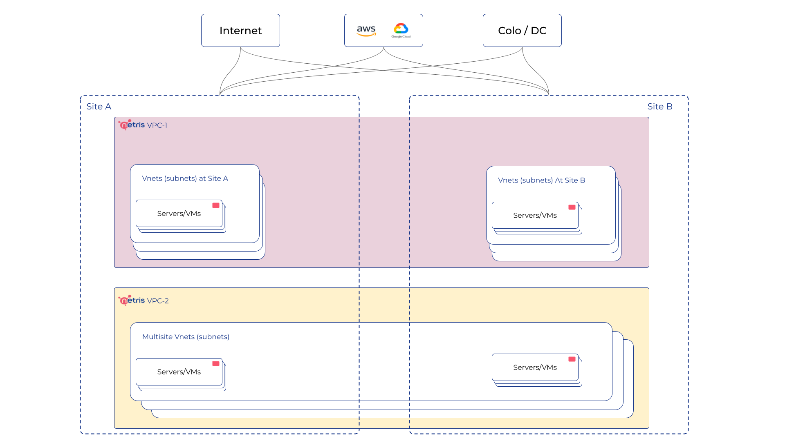
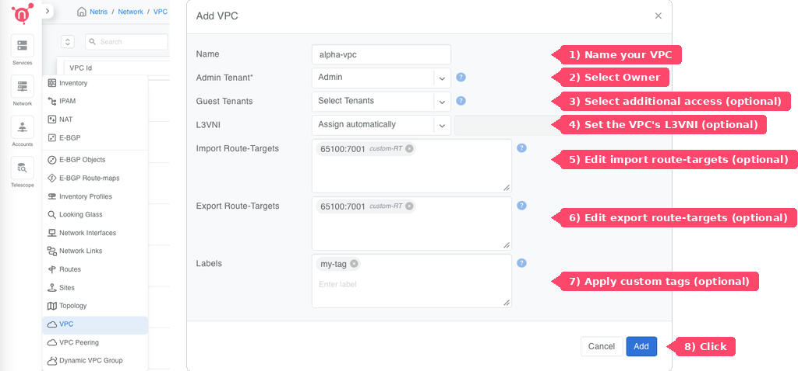
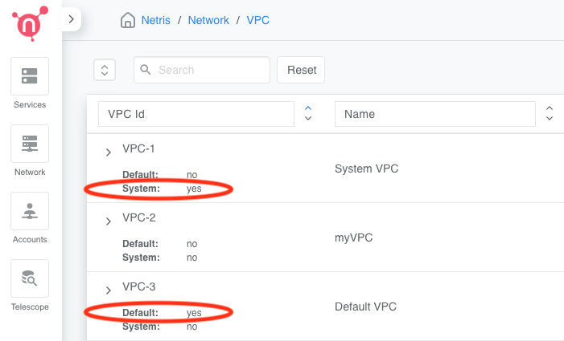
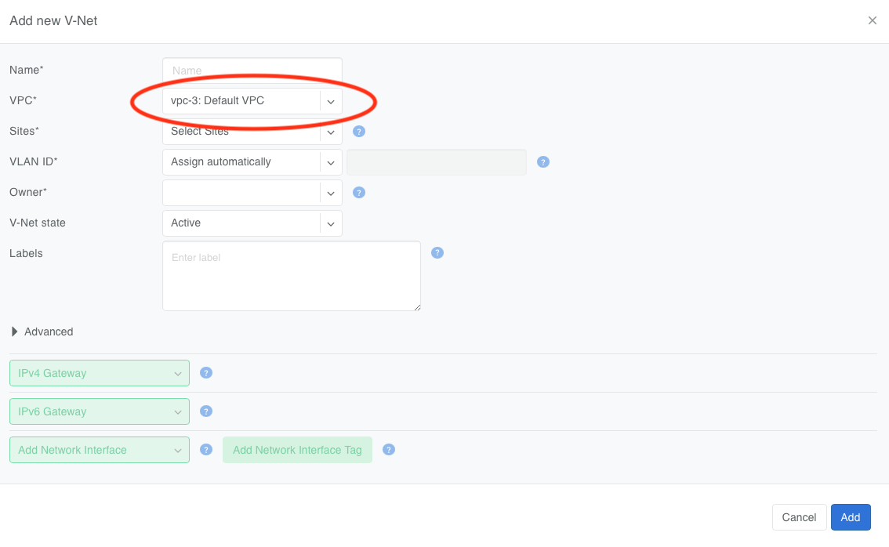

.. meta::
    :description: Netris VPC

.. _vpc_top:

==========
Netris VPC
==========

.. contents:: Table of Contents
   :local:
   :depth: 3

Overview
========

A **Virtual Private Cloud (VPC)** is the essence of Multi-Tenancy, one of the three pillars of the Netris NAAM (Network Automation, Abstraction, and Multi-Tenancy) platform (see :doc:`introduction`). It lets multiple tenants share the same physical infrastructure while remaining completely separated.

A Netris VPC lets you operate a group of resources inside a logically segregated virtual network, with each tenant's resources isolated from every other VPC. On Ethernet-based fabrics, each VPC maps to a dedicated VRF instance on the switch fabric, so different VPCs can use overlapping IP ranges without conflict. On InfiniBand and NVL72 integrations, the VPC construct is purely administrative — it does not translate into any specific configuration construct on the hardware itself.

VPC is the highest object in the Netris hierarchy and spans every :doc:`Site <site>` in the deployment. All other constructs, including V-Nets, IPAM allocations and subnets, BGP sessions, NAT rules, load balancers, and static routes, are **child objects** that belong to exactly one VPC. VPC Peering is the one construct that explicitly relates two VPCs, enabling controlled connectivity between otherwise isolated environments.

.. TODO: Diagram needs update with latest Netris collaterals (per Noam's review).

.. raw:: html

   
<em>Netris VPC concept diagram</em>

.. _vpc_vrf_placement:

How a VPC's VRF is placed on the fabric
==========================================

On Ethernet fabrics, a VPC maps to a VRF, but that VRF (and its associated L3 VNI) is not instantiated on every switch. Netris creates it on a given switch only where that switch hosts a Layer 3 service belonging to the VPC. Three things require it: a V-Net with an IP default gateway (an SVI), a BGP session terminated on that switch, or VPC peering. When the last such L3 service on a switch is removed, the switch withdraws the VRF and its L3 VNI.

A V-Net configured without an IP default gateway is a pure Layer 2 segment: it provisions only an L2 VNI, with no VRF or L3 VNI.

Because a BGP session on its own provisions the VRF, a VPC that contains only BGP sessions and no V-Nets still gets its VRF on the terminating switches — so it can take part in VPC peering without a placeholder V-Net.

Adding a new VPC
==================

VPCs are managed under ``Network -> VPC``, where you can create, edit, and remove them. Create new VPCs using the **Add** button. The Add VPC dialog defines the VPC's identity and access model:

.. raw:: html

   
<em>Figure: Add new VPC dialog</em>

.. tip::

   Netris automatically adds the relevant route targets of type default-RT when you save the form. You can inspect the added RTs by editing the newly created VPC.

   .. image:: images/vpc-edit.png
       :align: center
       :alt: Edit VPC dialog showing the generated route targets
       :class: with-shadow

   .. raw:: html

      
<em>Figure: Edit VPC dialog with the generated route targets</em>

.. list-table:: VPC Fields
   :header-rows: 1
   :widths: 20 45 35

   * - Field
     - What it does
     - Notes/defaults
   * - **Name**
     - Name of the VPC.
     - Required.
   * - **Admin Tenant**
     - The tenant that owns the VPC. Users granted access as this tenant can manage all of the VPC's own parameters (name, tags, tenants, and so on).
     - Required.
   * - **Guest Tenants**
     - Additional tenants (other than the Admin Tenant) allowed to add and remove services *inside* the VPC — V-Nets, L4 Load Balancers, Server Clusters, IPAM subnets, and the like — without being able to change the VPC's own parameters.
     - Optional; multiple allowed. See :doc:`accounts` for more on Admin vs. Guest Tenants.
   * - **L3VNI**
     - The VNI of the VPC's L3 VRF. **Assign automatically** takes the next free VNI. **Enter manually** accepts a value from 1 to 16777215 that no other VNI uses. Changing it on an existing VPC updates the route targets that still hold the old VNI, keeping their prefix.
     - Assign automatically by default. Set it manually to align the VPC with an L3VNI that an unmanaged VTEP already uses — see :doc:`Unmanaged EVPN VTEP <unmanaged-evpn-vtep>`.
   * - **Import Route-Targets** / **Export Route-Targets**
     - The route targets the VPC's L3VNI imports and exports. Netris pre-fills these; you can add, edit, or remove entries.
     - Optional. See :ref:`L3VNI and route targets <vpc-l3vni-route-targets>` below.
   * - **Tags**
     - Free-form labels you assign to the VPC for search/filter in the VPC listing. Same generic tagging mechanism used on V-Nets and other objects — it has no configuration effect on the VPC itself.
     - Optional; multiple allowed. Letters, numbers, ``_``, ``=``, ``-``, and ``.`` only.

.. _vpc-l3vni-route-targets:

L3VNI and route targets
=======================

Each VPC's L3VNI has an import list and an export list of route targets, shown in the VPC listing under **Internal L3VNI**.

Netris fills both lists when the VPC is created, with one ``default-RT`` per distinct Default Route-Target Prefix across the Sites, in the form ``<prefix>:<L3VNI>``. Creating a VPC peering adds a ``vpc-peering-RT`` (``<peering ID>:0``) to both lists of each member VPC; deleting the peering removes it.

Both lists are editable. An entry you add is recorded as ``custom-RT``; an entry you edit keeps its original type. Your changes are respected: an entry you remove is not regenerated by later edits to the VPC, its V-Nets, or its IPAM subnets. It reappears only on a new triggering event — a new VPC peering, or the VPC rejoining one.

A route target must be in ``<ASN>:<number>`` or ``<IPv4>:<number>`` form, and a value may appear only once per list.

.. warning::

   Edited and custom route targets are realized on **NVIDIA Cumulus Linux** switches only. Dell SONiC, Arista EOS, and EVPN-on-Host agents use ``0:<VNI>`` for the VPC VRF regardless of what the VPC's route-target lists contain. See :doc:`Unmanaged EVPN VTEP <unmanaged-evpn-vtep>`.

Deployments upgraded to Netris 4.21.0 retain the legacy ``0:<VNI>`` entry on VNIs that existed before the upgrade and also receive the new ``<prefix>:<VNI>`` entry, so existing route exchange on the fabric stays valid. Removing the legacy entry withdraws routes from any device still importing it.

.. _vpc_child_objects:

VPC child objects
==================

The table below lists the objects that belong to a VPC, what selecting a VPC for that object actually controls, and any placement restrictions. As a rule of thumb: if an object's VPC field is described below as "local/tenant," selecting a tenant VPC there does not put that object's public-facing side in the same VPC — the System VPC (see :ref:`System VPC and Default VPC <vpc_system_default>` below) is always the other end for NAT and load-balancer exit traffic.

.. list-table::
   :header-rows: 1
   :widths: 20 45 35

   * - Object
     - What the VPC field controls
     - Notes
   * - :doc:`V-Net <vnet>` (``Services -> V-Net``)
     - The VPC the network segment (and its endpoints) belongs to.
     - A V-Net belongs to exactly one VPC and one or more Sites.
   * - IPAM Allocation / Subnet (``Network -> IPAM``)
     - The VPC the allocation or subnet is filed under.
     - See :doc:`ipam`. A subnet's *Purpose* (common, loopback, management, load-balancer, nat, inactive) determines how it can be used; loopback, load-balancer, and nat subnets are conventionally created in the System VPC — see :ref:`System VPC and Default VPC <vpc_system_default>`. A subnet's *Global Routing* checkbox separately controls whether it can be advertised outside its own VPC to the System VPC (and potentially upstream) — see :ref:`Global Routing <ipam_global_routing>` on the IPAM page; it's pre-checked by default for subnets created directly in the System VPC.
   * - E-BGP peer (``Network -> E-BGP``)
     - The VPC where the BGP session's routes are injected.
     - The **BGP Router** field determines where the session terminates: a SoftGate-terminated session must use the System VPC; a switch- or V-Net-terminated session (Direct Connect, no SoftGate) can use any VPC, but doesn't get SoftGate NAT/load-balancer services.
   * - Static Route (``Network -> Routes``)
     - The VPC the route applies to.
     - Useful for pointing a VPC's default route somewhere other than a SoftGate, or for temporary migration routes.
   * - NAT rule (``Network -> NAT``)
     - The **local/tenant** VPC whose workloads are translated.
     - The public/exit side of the translation is always the System VPC — it is not a selectable field.
   * - :doc:`L4 Load Balancer <l4-load-balancer>` (``Services -> Load Balancer``)
     - The **local/tenant** VPC containing the backend endpoints.
     - Same exit behavior as NAT: the frontend virtual IP is served from the System VPC via SoftGate.
   * - VPC Peering (``Network -> VPC Peering``)
     - Two VPCs selectively exchange routes.
     - Commonly used to reach shared services (DNS, storage, and the like) from multiple tenant VPCs without giving those tenant VPCs a route to each other. See the :doc:`VPC Peering <vpc-peering>` page.
   * - :doc:`Server Cluster <server-cluster>` (``Services -> Server Cluster``)
     - Can create a brand-new VPC for you.
     - Setting VPC to **Create New** provisions a VPC along with its V-Nets and IPAM subnets in one step. See :doc:`server-cluster` for additional details.

.. _vpc_system_default:

System VPC and Default VPC
=============================

**In short:** every fresh deployment ships with one VPC — VPC-1 — that is both the System VPC (the infrastructure trust anchor) and the Default VPC (the fallback for unspecified VPC fields). These roles are separate but point to the same VPC by default; either can, in principle, point elsewhere.

VPC-1 is provisioned automatically during initial setup and cannot be deleted. As the **System VPC**, it's home to the platform's own infrastructure objects — switch loopback subnets, SoftGate eBGP sessions, and the public side of NAT and load balancer services. As the **Default VPC**, it's the fallback the Controller substitutes whenever an API call or dialog leaves the VPC field unspecified.

The System VPC role is about trust: it anchors objects the operator implicitly relies on. The Default VPC role is about convenience: it's a catch-all for calls that didn't specify a VPC. The distinction matters once you start creating additional VPCs for tenants — the following sections cover each role in detail.

.. raw:: html

   
<em>System and Default are independent flags: VPC-1 is System but not Default; VPC-3 is Default but not System</em>

What the Default VPC is for
----------------------------

The Default VPC is a **convenience/fallback mechanism**, not a trust or security boundary. Exactly one VPC in a deployment is flagged as Default.

In the web UI, the Default VPC is pre-selected in "Add new" dialogs for VPC-scoped objects. You can change the selection before saving, but if you don't, the object is created in whichever VPC is flagged as Default.

When using the API or Terraform, the same substitution happens if a call omits the VPC field: the Controller doesn't reject the request for a missing required value; it fills it in with the Default VPC.

.. raw:: html

   
<em>The VPC field in an Add new dialog comes pre-selected to whichever VPC is flagged Default</em>

Modern Netris integrations set the VPC field explicitly on every object, so in a current deployment, anything that lands in the Default VPC via this substitution is more often a sign of a missing or mistaken VPC field in a call than an intentional placement. See :ref:`Why they're the same VPC today <vpc_history>` for how this fallback mechanism came about.

.. tip::
   Because the Default VPC is a catch-all for calls that didn't specify a VPC, don't treat objects that land there as trusted or related to each other. Two V-Nets that both end up in the Default VPC through omission may belong to two completely different tenants that just happen to share the same "nobody specified a VPC" fate.

.. tip::
   Periodically audit the Default VPC's contents — it's a good way to catch missing ``VPC`` fields in Terraform/API calls.

What the System VPC is for
----------------------------

The System VPC is the **trust boundary and anchor point for platform/infrastructure objects** — the things every deployment needs regardless of how many tenants it serves. Concretely, the System VPC is where the following live:

.. list-table::
   :header-rows: 1
   :widths: 25 75

   * - Object
     - Why it lives here
   * - **Switch loopback and VTEP IPAM subnets**
     - Switch main loopback IPs operate in the underlay and, by definition, don't belong to any VPC/VRF — but Netris IPAM still needs a VPC to file that subnet under, since every IPAM subnet has a VPC parent. (This is purely an IPAM bookkeeping detail — the loopback IPs themselves are never actually configured inside the System VPC's VRF on the switch.) Note: the *Global Routing* checkbox is pre-checked by default on these subnets, same as any other subnet created in the System VPC; whether that has any operational effect for a loopback-purpose subnet is unconfirmed.
   * - **eBGP sessions terminated on SoftGate**
     - These are your upstream/external BGP sessions — peering with providers, border routers, or an IX — and they define the reachability Netris uses for SNAT egress and DNAT/load-balancer ingress.
   * - **Public/exit side of NAT and Load Balancer services**
     - The VPC field on a NAT rule or load balancer selects the *local tenant VPC* being served. The public-facing side (the SNAT pool, or the DNAT/load-balancer virtual IP) is always the System VPC; you don't select it, and you can't change it to another VPC.

.. important::
   **Constraint:** any eBGP peer whose BGP Router is set to a SoftGate node must be created in the System VPC. The Controller doesn't block other placements, but they are unsupported and may cause unexpected behavior. eBGP peers terminated directly on a switch, or V-Net (no SoftGate — Direct Connect) aren't restricted to the System VPC; see the E-BGP peer row in :ref:`VPC child objects <vpc_child_objects>`.

.. warning::
   Avoid creating V-Nets or servers in the System VPC and then relying on SNAT/DNAT or VPC Peering to reach them from tenant VPCs — this is not a supported pattern, even though the Controller does not block it outright. Keep tenant services in tenant VPCs, and use the System VPC only for the objects above.

.. tip::
   If you need a VPC for the operator's own shared infrastructure services (DNS, NTP, monitoring, and the like) that tenants should not have access to, create a dedicated VPC for it — do not reuse the System VPC for this purpose. The System VPC is for the platform's own BGP/NAT/loopback plumbing, not for "services I, the operator, own."

.. _vpc_history:

Historical note: why System VPC and Default VPC are the same VPC today
=========================================================================

VPC-1 doubles as both System VPC and Default VPC because of how multi-VPC support was introduced. Earlier Netris versions supported only a single VPC per deployment, so every object belonged to it by definition. When multi-VPC support shipped, that single, pre-existing VPC had to keep working as both the anchor for infrastructure objects (System VPC) and the landing zone for objects with no VPC specified (Default VPC), so upgraded deployments would keep functioning without any changes. New deployments inherited the same shipping default.

The practical result: anything you forget to assign a VPC to lands in the same VPC used for switch loopbacks, upstream BGP, and NAT/load-balancer exit traffic. If that combination doesn't fit your operational model, you can point the Default VPC flag at a different, non-system VPC — the System VPC's specific roles (loopbacks, SoftGate-terminated BGP, NAT/LB exit) stay with VPC-1 regardless of which VPC is flagged as default.
